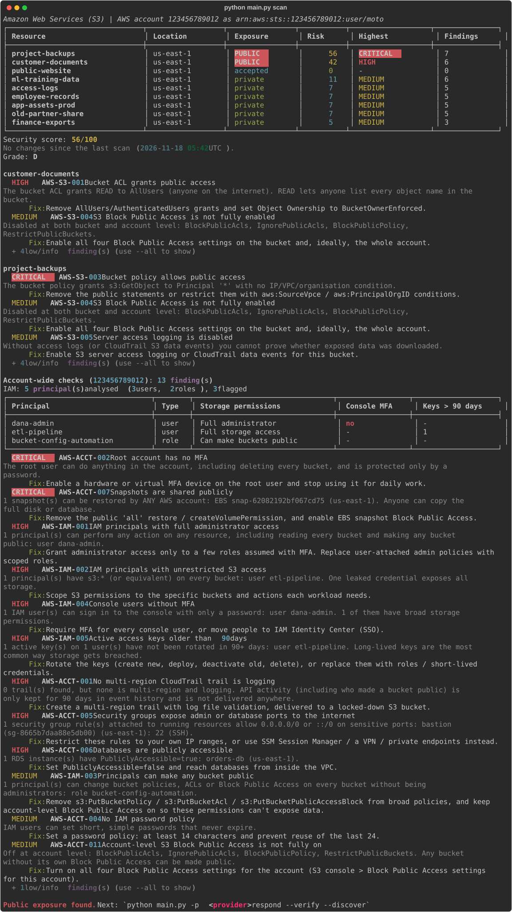
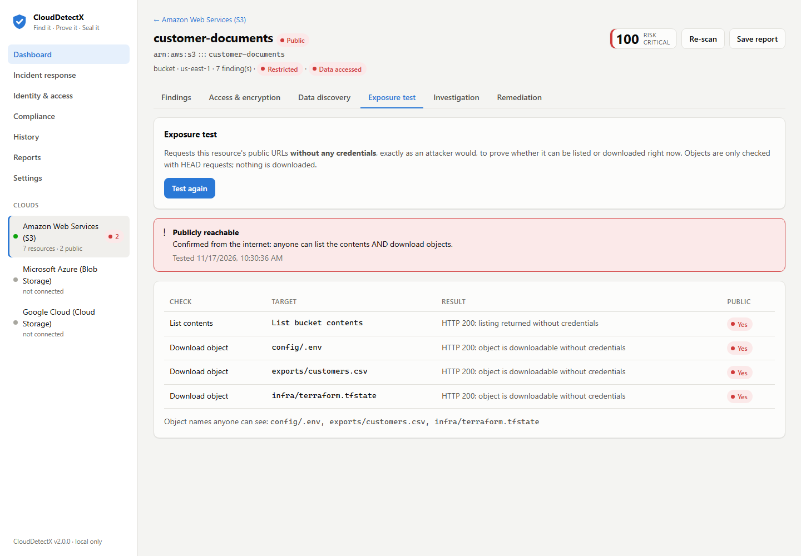
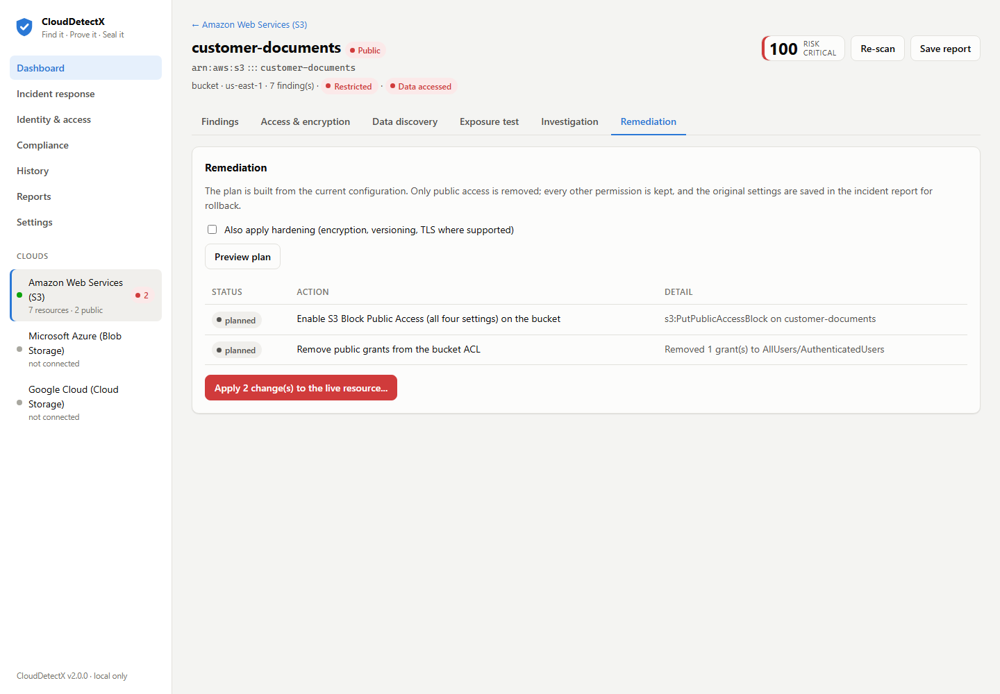
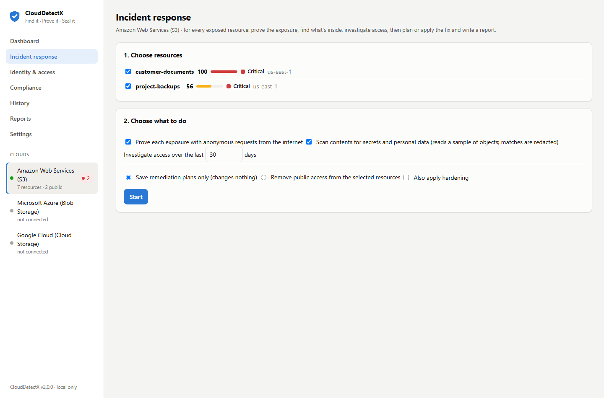
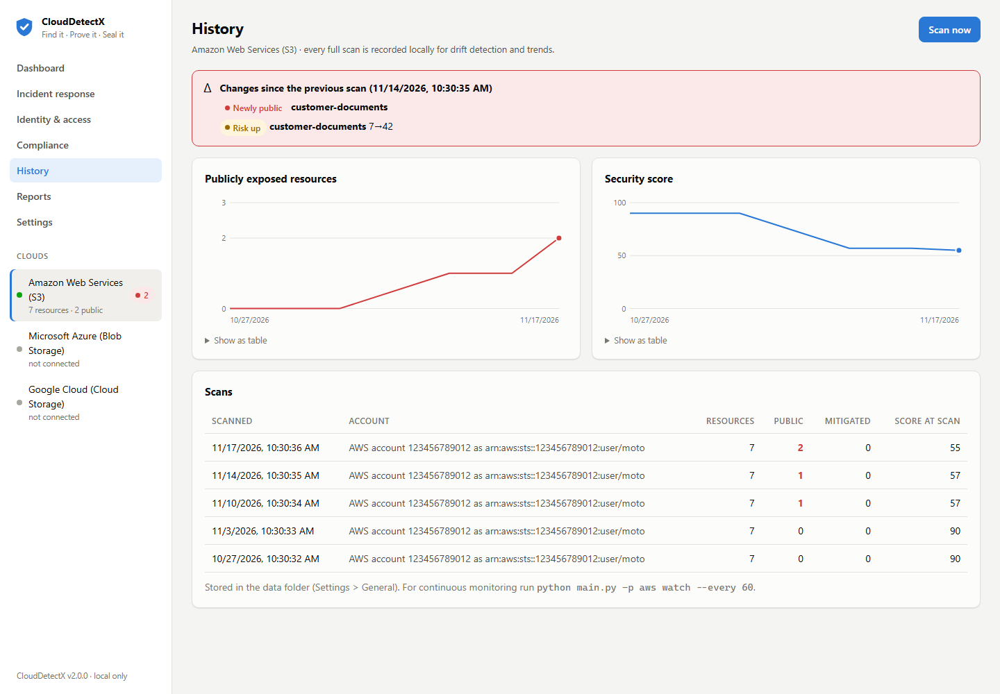
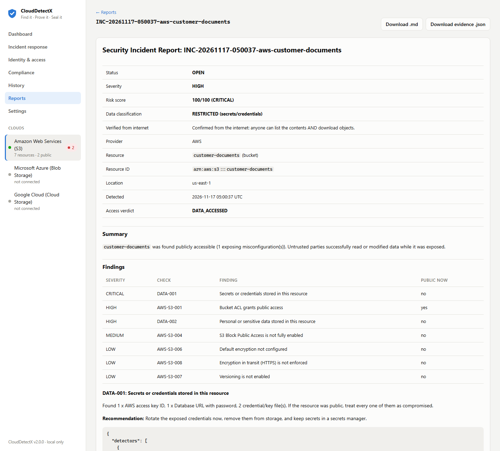
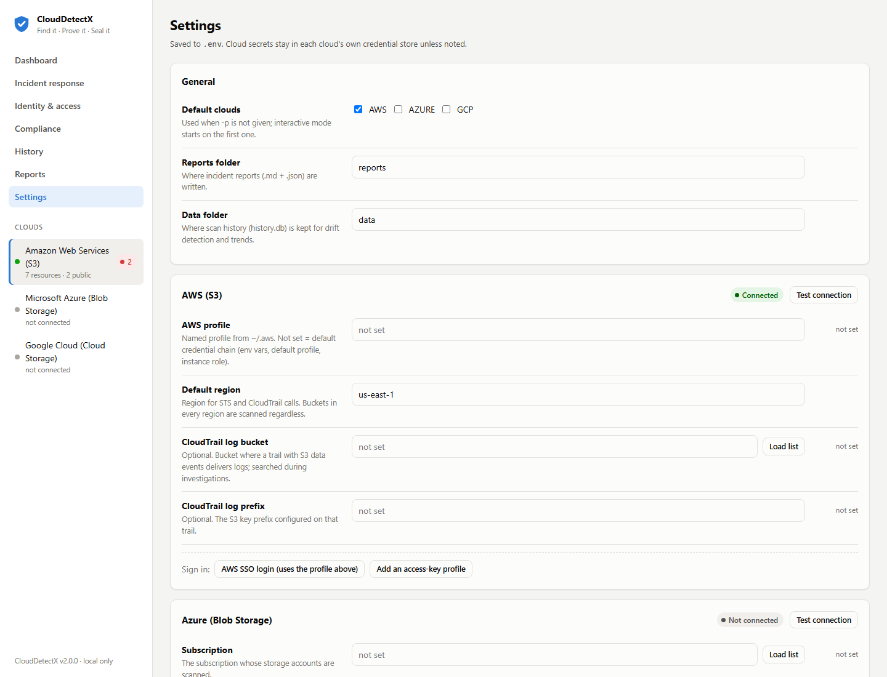
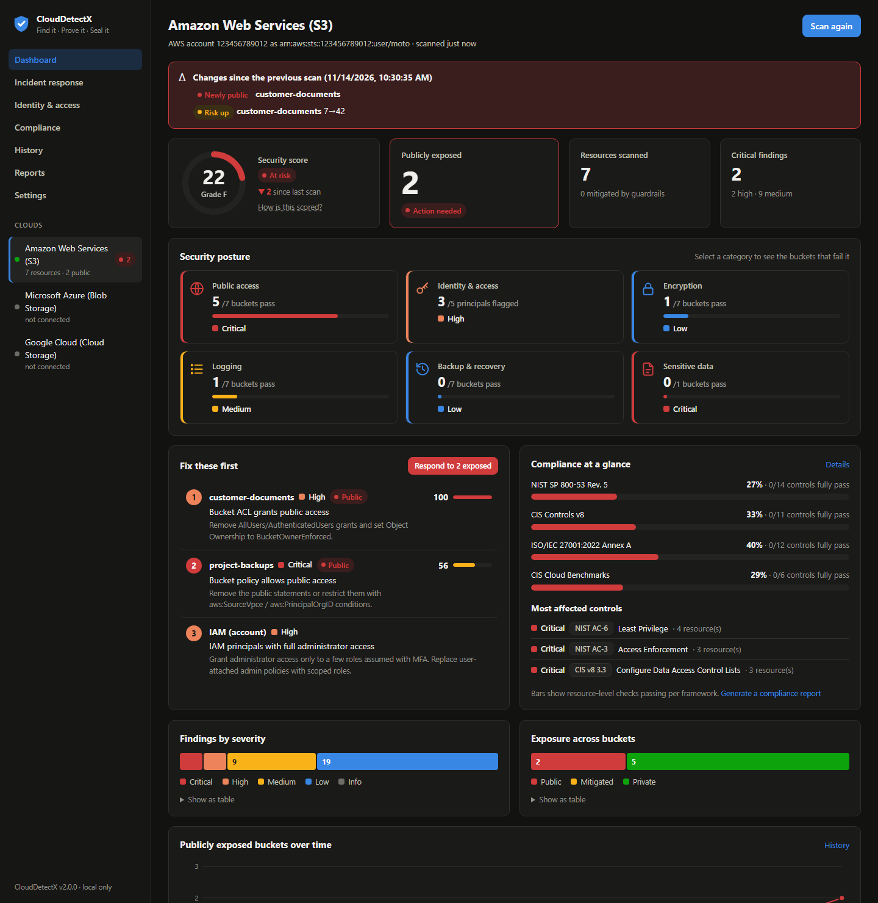

# 🛡️ CloudDetectX

> **Find it. Prove it. Seal it.**
> CloudDetectX finds publicly exposed cloud storage, proves whether it's really reachable and what's inside, works out who got in, and closes it with a full incident report.

CloudDetectX is an incident-response tool for **AWS S3, Azure Blob Storage and Google Cloud Storage**. It runs directly against your real cloud accounts using your existing logins, and you can use it from the **web dashboard**, an **interactive terminal UI**, or **scriptable commands** for cron and CI.

**Detect → Prove → Discover → Investigate → Remediate → Verify → Report → Monitor**

<picture>
  <source media="(prefers-color-scheme: dark)" srcset="docs/screenshots/dashboard-dark.png">
  
</picture>

<sub>All screenshots come from a simulated AWS account with planted fake data. See <a href="#-screenshots">Screenshots</a> for every page.</sub>

| | Capability | What it answers |
|---|---|---|
| 🔍 | **Exposure detection** | Which buckets or containers can anyone on the internet read, list or write? Which are *really* exposed, and which are already neutralised by Block Public Access / Public Access Prevention? |
| 👤 | **IAM permission analysis** (AWS) | Who can read, write or *make public* your storage? Finds administrators, users and roles with `s3:*` on every bucket, principals that can change bucket policies, console users without MFA, access keys older than 90 days, and buckets shared with other AWS accounts. |
| 🔒 | **Encryption checks** | Which buckets have no default encryption, which use S3-managed keys vs KMS, and which still accept plain HTTP (no `aws:SecureTransport` deny). |
| 🌐 | **Exposure verification** | Is it actually reachable right now? Requests the public URLs with **no credentials**, exactly as an attacker would. |
| 🔑 | **Sensitive data discovery** | What's inside? Detects secrets (cloud keys, private keys, tokens, database URLs) and personal data (cards, SSN, Aadhaar, PAN, IBAN, emails), plus risky files (`.env`, `terraform.tfstate`, SQL dumps, SSH keys). Matches are **redacted**. |
| 🕵️ | **Access investigation** | Was the data downloaded, by whom and from where (access logs)? Who made it public and when (audit logs)? Indicators are tagged with **MITRE ATT&CK** techniques. |
| 📊 | **Risk scoring** | A 0–100 score per resource that explains every point, plus an overall security score per cloud. |
| 📋 | **Compliance mapping and reports** | Which controls fail and how many pass: NIST SP 800-53, CIS Controls v8, ISO/IEC 27001:2022 and CIS cloud benchmarks, with a downloadable **compliance report** (Markdown + JSON evidence). |
| 🔐 | **Remediation** | Closes public access with the fastest containment control first, keeps every non-public permission, saves the original configuration for rollback, and re-scans to prove the fix. |
| 📈 | **Drift and monitoring** | What changed since the last scan? A local scan history, trend charts, `watch` mode, and Slack/Teams/webhook alerts. |
| 📄 | **Incident reports** | A Markdown report for people and a JSON evidence file for tooling and SIEMs. |

---

## 🛡️ Safety model

CloudDetectX works on production accounts, so it is careful by design:

- **Read-only by default**: `scan`, `iam`, `verify`, `discover`, `investigate`, `compliance`, `history` and `watch` change nothing.
- **Remediation is explicit**: the plan is always shown first. Applying it requires typing the resource name (web and terminal UI) or confirming the prompt (CLI, unless `--yes`). `--dry-run` only shows the plan.
- **Minimal changes**: only public grants are removed. Other ACL grants, policy statements and IAM bindings are kept, and the previous configuration is saved in the report.
- **Secrets never leave redacted form**: discovery stores and shows only masked samples (`AKIA••••••••LE`, `••••••••••••1111`). Full values are never written to reports, history or the dashboard.
- **Verification is gentle**: anonymous checks use only HEAD requests for objects and read only the first page of a listing.
- **Untrusted data is escaped**: object names and user agents in logs are attacker-controlled, so reports and the dashboard escape and sanitise them.
- **The dashboard is local**: it listens only on `127.0.0.1` and needs the one-time link printed in the terminal.

---

## 🚀 Setup

```bash
git clone https://github.com/dipanshwave/cloud-storage-exposure-solution
cd cloud-storage-exposure-solution
python -m venv .venv
.venv\Scripts\activate          # Windows  (source .venv/bin/activate on Linux/macOS)
pip install -r requirements.txt
python main.py                  # the first run starts the setup wizard
```

### Configuration (all from the app)

You never need to edit a file. The **setup wizard** runs on first use, or any time with `python main.py config wizard`. It:

1. asks which clouds you use;
2. signs you in to each one:
   - **AWS**: an existing profile, a new access-key profile (written to `~/.aws` like `aws configure`, never to `.env`), AWS SSO, or the default credential chain;
   - **Azure**: `az login`, device-code login, or a service principal, then pick the subscription from a list;
   - **GCP**: `gcloud auth application-default login` or a service-account key file, then pick the project from a list;
3. tests each connection;
4. sets investigation options.

Every setting is also available under **Settings** in the web dashboard or terminal UI, or from scripts:

```bash
python main.py config show
python main.py config set lookback_days 90
python main.py config set trusted-cidrs "203.0.113.0/24,10.0.0.0/8"
echo "$WEBHOOK" | python main.py config set CLOUDDETECTX_WEBHOOK_URL     # secrets: pipe or get prompted
```

Settings live in `.env` in the project folder (git-ignored). [.env.example](.env.example) lists every variable. Variables use the `CLOUDDETECTX_` prefix.

---

## 🧭 Usage

### Web dashboard

```bash
python main.py web                  # opens http://127.0.0.1:8765
```

| Page | What's there |
|---|---|
| **Dashboard** | Security-score gauge with grade and change since the last scan; publicly exposed count; **security posture** tiles for public access, identity & access, encryption, logging, backup and sensitive data (select one to filter the resource table); a **fix these first** list; compliance pass rates and the most affected controls; severity, exposure and trend charts; and a resource table with risk, encryption, data classification and access verdict. |
| **Resource** | Tabs: **Findings** (risk breakdown, evidence, mapped controls), **Access & encryption** (who in the account can read / write / change access, other AWS accounts with access, encryption at rest and in transit), **Data discovery**, **Exposure test**, **Investigation** (verdict, MITRE-tagged indicators, downloaded objects, attacker IPs, change history, timeline), **Remediation** (plan, then type-the-name confirmation). |
| **Incident response** | Tick exposed resources. Then prove, discover, investigate, and either save plans or fix them, with a live log and a summary. |
| **Identity & access** | IAM findings with mapped controls, and every user and role with its storage permissions, console MFA and access-key age (AWS). |
| **Compliance** | Pass rates per framework, failing controls with the affected resources, and a **Generate compliance report** button. |
| **History** | Exposure and security-score trends, plus every recorded scan. |
| **Reports / Settings** | Read and download reports; every setting, sign-in buttons, connection tests and a test-alert button. |

### Interactive terminal

```bash
python main.py              # arrow-key menus; Ctrl+C goes back
python main.py -p azure     # start on Azure
```

### Commands (scripts, cron, CI)

```bash
python main.py -p aws,azure,gcp scan          # risk-scored scan + IAM analysis + drift + alerts
python main.py -p aws iam                     # who can access storage (IAM users, groups, roles)
python main.py -p aws verify my-bucket        # anonymous requests from the internet
python main.py -p aws discover my-bucket      # secrets / personal data inside (redacted)
python main.py -p aws investigate my-bucket --days 90
python main.py -p aws remediate my-bucket --dry-run
python main.py -p aws respond --verify --discover --remediate
python main.py -p aws compliance --report     # pass rates + compliance report (Markdown + JSON)
python main.py -p aws compliance --framework nist --json controls.json
python main.py -p aws history
python main.py -p aws,gcp watch --every 30    # continuous monitoring with drift alerts
python main.py alert-test
```

Exit codes: `0` = nothing exposed or everything contained, `2` = exposure found or still open, `1` = error.

<details>
<summary>Example: <code>python main.py scan</code> output</summary>



</details>

---

## 📸 Screenshots

Captured from the real web dashboard running against a simulated AWS account with planted fake secrets and personal data. Attacker IPs use documentation-reserved ranges.

### Identity & access

**Who can reach your storage**: IAM findings mapped to controls, then every principal with its storage permissions, MFA and key age.


### A resource, tab by tab

**Findings**: the risk score explains every point, and each finding lists the controls it fails.


**Access & encryption**: who in the account can read, write or change access to this bucket, and how its data is encrypted.


**Data discovery**: what's inside, with every match redacted.


**Exposure test**: proof from the internet, with no credentials.



**Investigation**: who downloaded what, from where, and who made it public.


**Remediation**: the plan comes first, and applying it needs typed confirmation.



### Across the account

| Incident response | Compliance |
|---|---|
|  |  |
| **History** | **Incident report** |
|  |  |
| **Settings** | **Dark mode** |
|  |  |

---

## 🔬 What it checks

### AWS S3
| Check | Severity |
|---|---|
| Bucket ACL grants `AllUsers` / `AuthenticatedUsers` | HIGH, or CRITICAL if write |
| Objects with public ACLs (sampled) | CRITICAL |
| Bucket policy with `Principal: "*"` and no IP/VPC/organisation condition | CRITICAL |
| Block Public Access not fully enabled (bucket and account) | MEDIUM |
| Server access logging disabled | MEDIUM |
| Bucket policy grants access to other AWS accounts without an organisation condition (`AWS-S3-009`) | MEDIUM, or HIGH if write |
| HTTPS not enforced: no `aws:SecureTransport` deny (`AWS-S3-008`) | LOW |
| No default encryption / versioning disabled | LOW |

### AWS IAM (account-wide, read-only)
| Check | Severity |
|---|---|
| `AWS-IAM-001` Principals with full administrator access (`*` on `*`) | HIGH if any are users, else MEDIUM |
| `AWS-IAM-002` Principals with `s3:*` (or equivalent) on every bucket | HIGH if a user with access keys, else MEDIUM |
| `AWS-IAM-003` Non-admin principals that can change bucket policies, ACLs or Block Public Access on every bucket | MEDIUM |
| `AWS-IAM-004` Console users without MFA | HIGH if they have broad storage access, else MEDIUM |
| `AWS-IAM-005` Active access keys older than 90 days | HIGH if the user has broad storage access, else MEDIUM |

IAM analysis reads `GetAccountAuthorizationDetails` once (users, groups, roles, inline and managed policies) and evaluates Allow statements minus unconditional Denys. Permissions granted only under a condition are marked *conditional*. It does not evaluate permission boundaries, SCPs or session policies, and AWS service-linked roles are skipped. Each bucket's **Access & encryption** tab shows who can read, list, write or change access to it.

### Azure Blob Storage
| Check | Severity |
|---|---|
| Containers with `Blob` / `Container` access while the account allows it | CRITICAL |
| `allowBlobPublicAccess` enabled or unset | MEDIUM |
| Firewall open to all networks | MEDIUM |
| Blob diagnostic logs not enabled | MEDIUM |
| HTTPS not enforced / TLS < 1.2 / shared-key auth / no soft delete | LOW–MEDIUM |

### Google Cloud Storage
| Check | Severity |
|---|---|
| IAM bindings to `allUsers` / `allAuthenticatedUsers` | CRITICAL |
| Bucket or object ACLs granting public access | HIGH / CRITICAL |
| Public Access Prevention not enforced | MEDIUM |
| Usage logging disabled | MEDIUM |
| Uniform bucket-level access / versioning disabled | LOW |

### Data findings (from discovery)
| Check | Severity |
|---|---|
| `DATA-001` Secrets or credentials stored in the resource | CRITICAL if public, else HIGH |
| `DATA-002` Personal or sensitive data stored in the resource | HIGH if public, else MEDIUM |

---

## 🔑 Sensitive data discovery

| Category | Detectors |
|---|---|
| Secrets | AWS access/secret keys, PEM private keys, GCP service-account keys, Azure storage connection strings and SAS tokens, GitHub/Slack/Stripe/Google API tokens, JWTs, database URLs with passwords, hard-coded passwords and API keys (placeholders such as `${VAR}` are ignored) |
| Personal data | Payment cards (Luhn and issuer validated), US SSN, Aadhaar (Verhoeff checksum), PAN, IBAN (mod-97), email addresses in bulk |
| Risky files | `.env`, SSH keys, `.pem`/`.p12`/`.pfx`, credentials files, `terraform.tfstate`, kubeconfig, password databases, `.git/config`, SQL dumps and backups |

Discovery samples objects, putting risky names and text files first, and reads only the start of each object. The limits are in *Settings → Sensitive data discovery*. Binary formats (images, archives, PDF, Office) are not content-scanned. Results classify the resource as **Restricted**, **Confidential**, **Internal** or **Nothing sensitive**.

## 🕵️ Investigation sources

| Cloud | Who accessed the data | Who made it public |
|---|---|---|
| AWS | S3 server access logs, plus optional CloudTrail S3 data events | CloudTrail event history (90 days) |
| Azure | `StorageBlobLogs` in Log Analytics | Azure Activity Log |
| GCP | Usage logs and Data Access audit logs. Audit logs don't record anonymous reads, so usage logs matter. | Admin Activity audit logs |

Verdicts: `DATA_ACCESSED`, `EXPOSURE_PROBED`, `NO_EVIDENCE_OF_ACCESS`, `NO_LOGS_AVAILABLE`.

MITRE ATT&CK tagging:
- **T1530** Data from Cloud Storage
- **T1619** Cloud Storage Object Discovery
- **T1565.001** Stored Data Manipulation
- **T1485** Data Destruction
- **T1595** Active Scanning

## 📊 Risk score

Points are added for public exposure (35–45), public write access (+10), exposure confirmed from the internet (+10), data classification (Restricted +30, Confidential +20), access evidence (data accessed +25, probed +10, no logs +8), and hardening gaps (up to +20). The score is capped at 100.

The **security score** per cloud is `100 − (0.7 × worst risk + 0.3 × average risk)`. One badly exposed bucket among hundreds still pulls it down.

## 📋 Compliance mapping and reports

Findings map to **NIST SP 800-53 Rev. 5** (e.g. AC-3, AC-6(5), AU-2, IA-2(1), SC-8, SC-28), **CIS Controls v8** (e.g. 3.3, 3.11, 5.4, 6.3, 6.8, 8.2), **ISO/IEC 27001:2022 Annex A** (e.g. A.5.15, A.8.2, A.8.3, A.8.12, A.8.24) and the **CIS AWS/Azure/GCP benchmarks** (e.g. "S3 Bucket Policy is set to deny HTTP requests", "MFA is enabled for all IAM users that have a console password").

For each framework CloudDetectX reports two numbers:
- **Resource-level pass rate**: of every (resource, control) pair a scan evaluates, the share with no failing check. This is the headline number on the dashboard.
- **Controls fully passing**: controls that no resource fails. This is strict: one bucket out of hundreds fails the whole control.

A **compliance report** (`CMP-<date>-<cloud>.md` plus a `.json` evidence file) contains:
- a framework summary;
- results per security category (public access, identity & access, encryption, logging, backup, sensitive data);
- failing controls with the affected resources, and passing controls;
- a per-resource table with encryption at rest and HTTPS enforcement;
- the IAM principals that were flagged;
- every finding with its fix.

Generate it from the Compliance page, the terminal menu, or `python main.py compliance --report`.

Cloud benchmarks renumber between versions, so they're cited by recommendation title, with numbers only where stable (GCP 5.1, 5.2). Treat all of this as audit evidence input, not a certification.

## 📈 History, drift and alerts

Every full scan is stored in `data/history.db`. Each scan reports:
- **newly public** and **no longer public** resources;
- new and removed resources;
- new findings;
- risk increases.

Alerts go to a Slack, Microsoft Teams or generic webhook (*Settings → Alerts*) when a new exposure reaches the risk threshold, and **always** when an investigation confirms data access. `watch` re-scans on a schedule.

---

## 🔐 Remediation steps

| Cloud | Containment (applied first) | Clean-up | `--harden` |
|---|---|---|---|
| AWS | All four Block Public Access settings on the bucket | Strip public ACL grants (bucket and objects); remove only the public policy statements | Require HTTPS (adds a `DenyInsecureTransport` statement, keeping every other statement), SSE-S3 encryption, versioning |
| Azure | `allowBlobPublicAccess = false` | Set each public container to Private | HTTPS only + TLS 1.2 |
| GCP | `publicAccessPrevention = enforced` | Remove `allUsers`/`allAuthenticatedUsers` from IAM; revoke public ACLs | Uniform bucket-level access, versioning |

---

## 🔑 Permissions needed

**Read-only (scan, verify, investigate)**
- **AWS**: the managed `SecurityAudit` policy, plus `s3:GetObject` on log buckets. `SecurityAudit` already includes what IAM analysis needs: `iam:GetAccountAuthorizationDetails`, `iam:ListAccessKeys`, `iam:ListMFADevices` and `iam:GetLoginProfile`.
- **Azure**: `Reader` + `Monitoring Reader` on the subscription, and `Log Analytics Reader`.
- **GCP**: `roles/iam.securityReviewer` + `roles/storage.objectViewer` on log buckets, and `roles/logging.privateLogViewer`.

**Discovery (reads object contents)**
- **AWS**: `s3:ListBucket` + `s3:GetObject`.
- **Azure**: `Storage Blob Data Reader`. Public containers fall back to anonymous access.
- **GCP**: `roles/storage.objectViewer`.

**Remediation**
- **AWS**: `s3:PutBucketPublicAccessBlock`, `s3:PutBucketAcl`, `s3:PutBucketPolicy`, `s3:DeleteBucketPolicy`, `s3:PutObjectAcl` (+ encryption and versioning for `--harden`).
- **Azure**: `Storage Account Contributor`.
- **GCP**: `storage.buckets.update`, `storage.buckets.setIamPolicy`, `storage.objects.setIamPolicy`.

---

## 🏗️ Project structure

```text
clouddetectx/
├── web/               # local web dashboard (FastAPI + plain HTML/CSS/JS, no build step)
├── interactive.py     # arrow-key terminal UI
├── cli.py             # commands for scripts / cron / CI
├── config.py          # every setting defined once (validation, .env storage)
├── config_ui.py       # settings menu, cloud sign-in, setup wizard
├── engine.py          # workflow orchestration, after-scan scoring/history/alerts
├── sensitive.py       # secret & personal-data detectors, redaction
├── probe.py           # anonymous exposure verification
├── risk.py            # risk score and security score
├── iam.py             # IAM permission analysis (who can read / write / expose storage)
├── overview.py        # security categories, priorities and compliance pass rates
├── compliance.py      # NIST / CIS / ISO / benchmark and MITRE ATT&CK mappings
├── history.py         # SQLite scan history and drift detection
├── alerts.py          # webhook alerts
├── analysis.py        # access-log analysis and verdicts
├── reporting.py       # Markdown + JSON incident and compliance reports
├── models.py
└── providers/         # aws.py, azure.py, gcp.py behind one StorageProvider interface
docs/screenshots/      # images used in this README
main.py
```

To add a cloud, implement `StorageProvider` in `clouddetectx/providers/` and register it in `providers/__init__.py`.

---

## 🗺️ Roadmap

- [x] AWS, Azure and GCP exposure detection and remediation
- [x] Access investigation and "who made it public" change history
- [x] Sensitive-data discovery with redaction
- [x] Anonymous exposure verification
- [x] Risk and security scores
- [x] Compliance and MITRE ATT&CK mapping
- [x] Scan history, drift detection, webhook alerts and watch mode
- [x] Web dashboard, terminal UI and CLI
- [x] AWS IAM permission analysis, encryption checks and compliance reports
- [ ] Azure RBAC and Google Cloud IAM permission analysis
- [ ] Organisation-wide scanning (all AWS accounts / Azure subscriptions / GCP projects)
- [ ] One-click rollback from a report's saved configuration
- [ ] SARIF / OCSF export for SIEM and code-scanning integrations

---

## ⚠️ Disclaimer

For **defensive security and authorised use only**. Run CloudDetectX only against cloud accounts you own or have explicit permission to assess and modify. Exposure verification sends unauthenticated requests to your own resources' public endpoints, and discovery reads object contents, which may incur provider request and egress charges.

> **Find the exposure before the internet does.**
