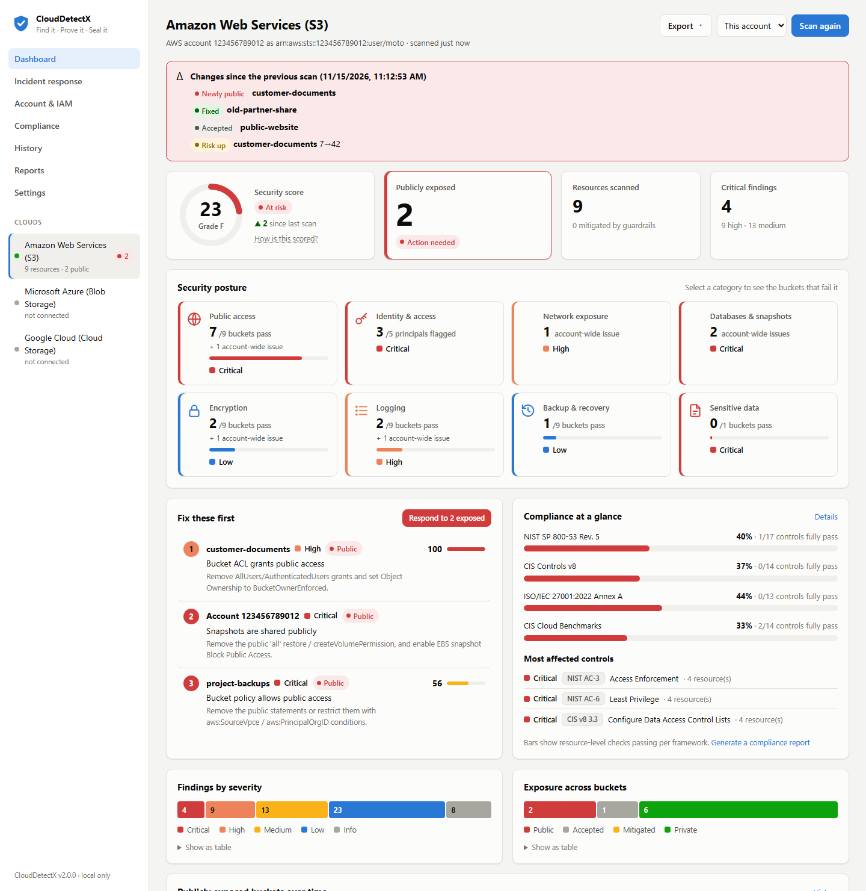
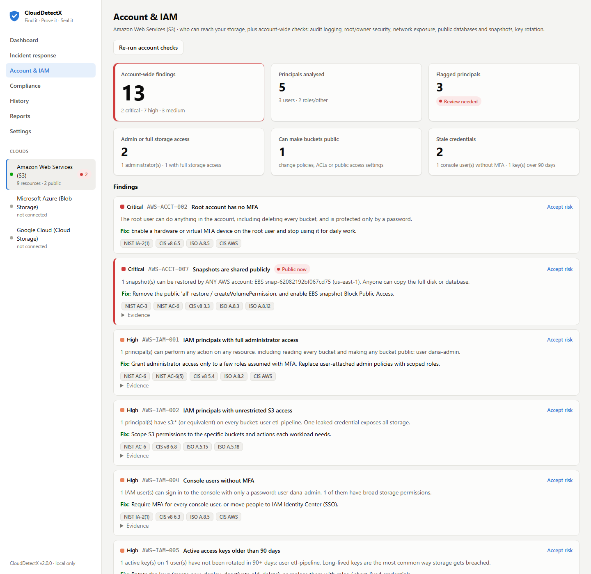
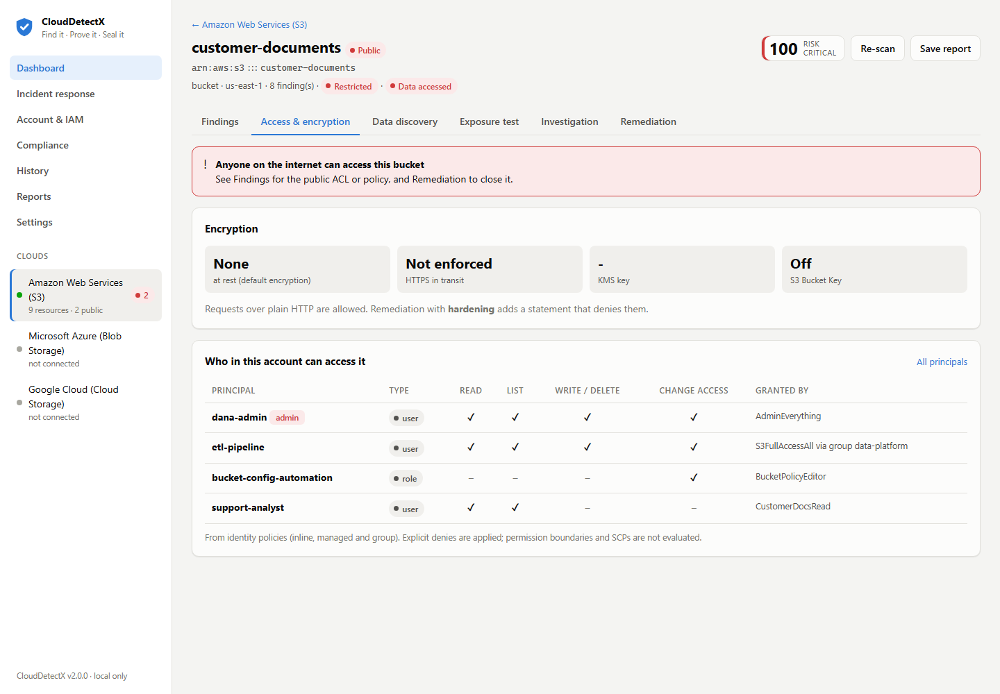
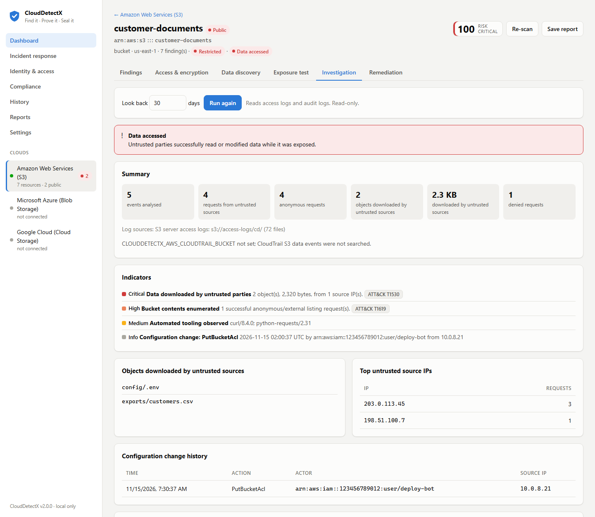
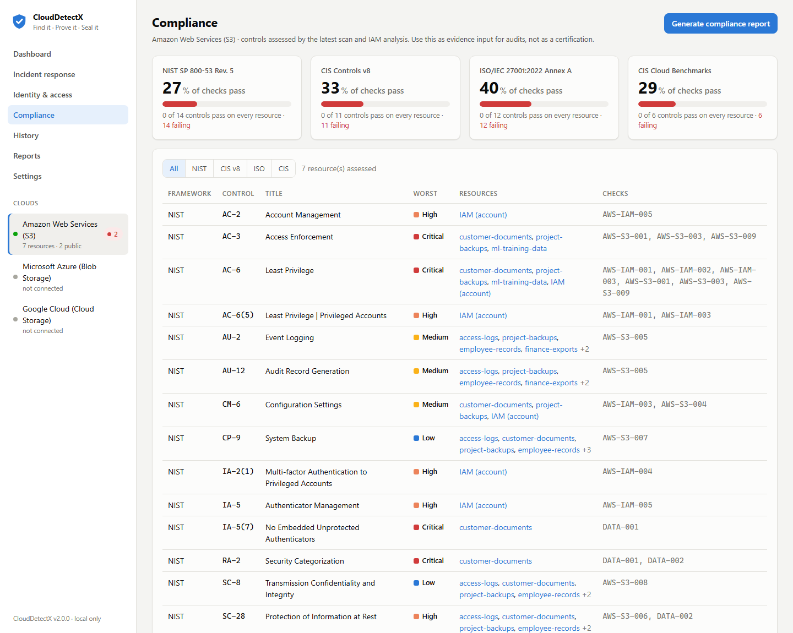
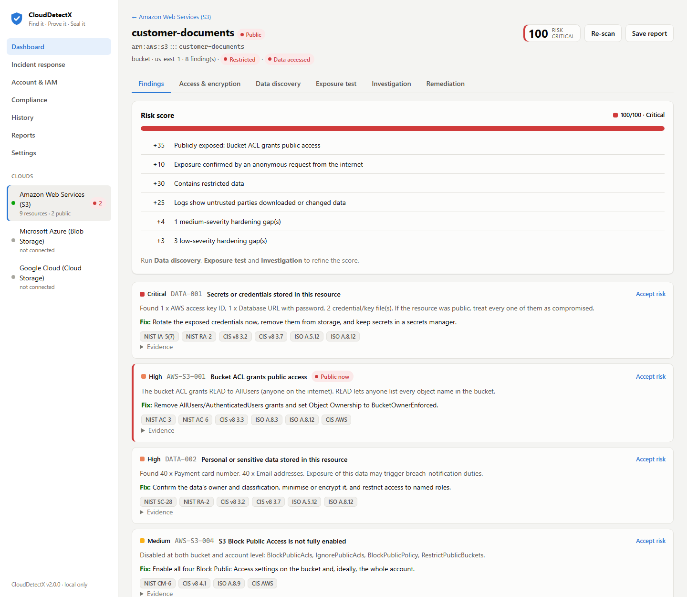

# 🛡️ CloudDetectX

> **Find it. Prove it. Seal it.** Find exposed cloud storage, prove what's reachable and what's inside, see who got in, and close it, with a report at the end.

CloudDetectX checks **AWS S3, Azure Blob Storage and Google Cloud Storage** for misconfigurations, using your existing cloud logins. It runs as a local **web dashboard**, an **interactive terminal UI**, or **scriptable commands**.

<picture>
  <source media="(prefers-color-scheme: dark)" srcset="docs/screenshots/dashboard-dark.png">
  
</picture>

<sub>Screenshots use a simulated AWS account with fake data.</sub>

## What it does

- **Detects exposure**: public ACLs, policies and containers, missing Block Public Access / Public Access Prevention, buckets shared with other accounts.
- **Checks IAM (AWS)**: admins, users and roles with `s3:*` on every bucket, principals that can make buckets public, console users without MFA, access keys older than 90 days, and who can access each bucket.
- **Checks encryption and logging**: default encryption, HTTPS enforcement, access logging, versioning / soft delete.
- **Proves it**: requests public URLs with no credentials, like an attacker would.
- **Finds sensitive data**: secrets, keys and personal data inside buckets. Every match is redacted.
- **Investigates**: who downloaded what and from where (access logs), and who made it public (audit logs), tagged with MITRE ATT&CK.
- **Scores and maps**: a 0–100 risk score per resource and a graded security score, mapped to NIST 800-53, CIS Controls v8, ISO 27001 and the CIS cloud benchmarks.
- **Fixes it**: removes public access only, keeps other permissions, saves the old configuration, and re-scans to confirm.
- **Reports and monitors**: incident and compliance reports (Markdown + JSON), scan history with drift detection, `watch` mode and Slack/Teams/webhook alerts.

## Quick start

```bash
git clone https://github.com/dipanshwave/cloud-storage-exposure-solution
cd cloud-storage-exposure-solution
python -m venv .venv
.venv\Scripts\activate            # Linux/macOS: source .venv/bin/activate
pip install -r requirements.txt
python main.py                    # first run starts the setup wizard
```

Everything is configured from the app: the setup wizard, **Settings** in the web dashboard or terminal menu, or `python main.py config`. Settings are saved to `.env` (git-ignored). See [.env.example](.env.example) for the full list.

## Usage

```bash
python main.py web                            # web dashboard at http://127.0.0.1:8765
python main.py                                # interactive terminal menus

python main.py -p aws,azure,gcp scan          # scan + risk score + drift + alerts
python main.py -p aws iam                     # who can access storage
python main.py -p aws verify my-bucket        # test from the internet, no credentials
python main.py -p aws discover my-bucket      # find secrets / personal data (redacted)
python main.py -p aws investigate my-bucket --days 90
python main.py -p aws remediate my-bucket --dry-run
python main.py -p aws respond --verify --discover --remediate
python main.py -p aws compliance --report     # compliance report (Markdown + JSON)
python main.py -p aws watch --every 30        # re-scan and alert on new exposure
```

Exit codes: `0` nothing exposed, `2` exposure found, `1` error. Run `python main.py <command> --help` for options.

## Screenshots

| Identity & access | Access & encryption |
|---|---|
|  |  |
| **Data discovery** | **Investigation** |
|  |  |
| **Compliance** | **Findings** |
|  |  |

More are in [docs/screenshots](docs/screenshots/), including exposure test, remediation, history, reports, settings and [CLI output](docs/screenshots/cli-scan.svg).

## Safety

- **Read-only by default.** Only `remediate`, `respond --remediate` and the dashboard's Remediation tab change anything. They show the plan first and need confirmation.
- **Minimal changes.** Only public access is removed (plus optional hardening with `--harden`). The original configuration is saved in the report.
- **Secrets stay redacted** in reports, history and the dashboard.
- **The dashboard is local only**: it listens on `127.0.0.1` and is opened with a one-time link.

## Permissions

| | Read-only (scan, iam, investigate) | Discovery | Remediation |
|---|---|---|---|
| **AWS** | `SecurityAudit` + `s3:GetObject` on log buckets | `s3:ListBucket`, `s3:GetObject` | `s3:PutBucketPublicAccessBlock`, `PutBucketAcl`, `PutBucketPolicy`, `DeleteBucketPolicy`, `PutObjectAcl` |
| **Azure** | `Reader`, `Monitoring Reader`, `Log Analytics Reader` | `Storage Blob Data Reader` | `Storage Account Contributor` |
| **GCP** | `roles/iam.securityReviewer`, `roles/logging.privateLogViewer` | `roles/storage.objectViewer` | `storage.buckets.update`, `storage.buckets.setIamPolicy`, `storage.objects.setIamPolicy` |

## Limits

- Covers **storage** and **AWS IAM** only. It is not a full cloud security scanner: virtual machines, databases, networking and Kubernetes aren't checked.
- IAM analysis reads policies directly. It doesn't evaluate SCPs, permission boundaries or condition values.
- Compliance mapping is audit evidence, not a certification.
- Discovery and verification can incur small request/egress charges.

## Project layout

```text
clouddetectx/
├── providers/      aws.py, azure.py, gcp.py
├── web/            local dashboard (FastAPI + plain JS)
├── cli.py          commands        interactive.py  terminal UI
├── iam.py          IAM analysis    sensitive.py    data discovery
├── compliance.py   control maps    reporting.py    reports
└── ...             risk, history, alerts, probe, analysis
```

---

For **authorised use only**: scan only accounts you own or have permission to assess.
