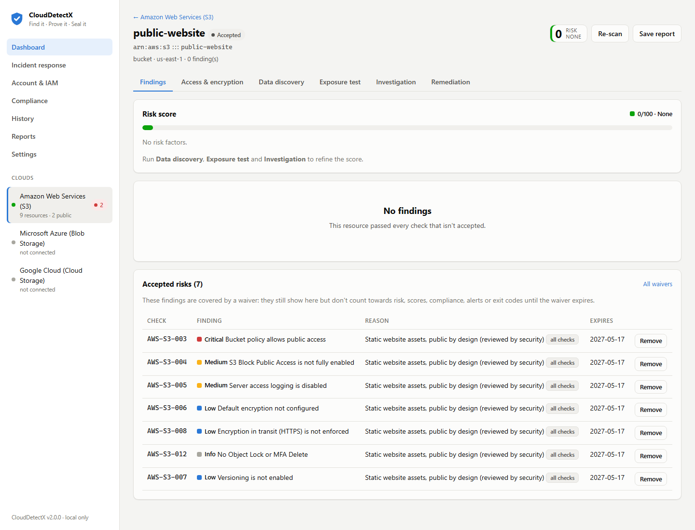
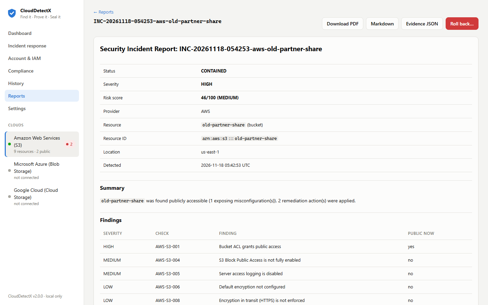
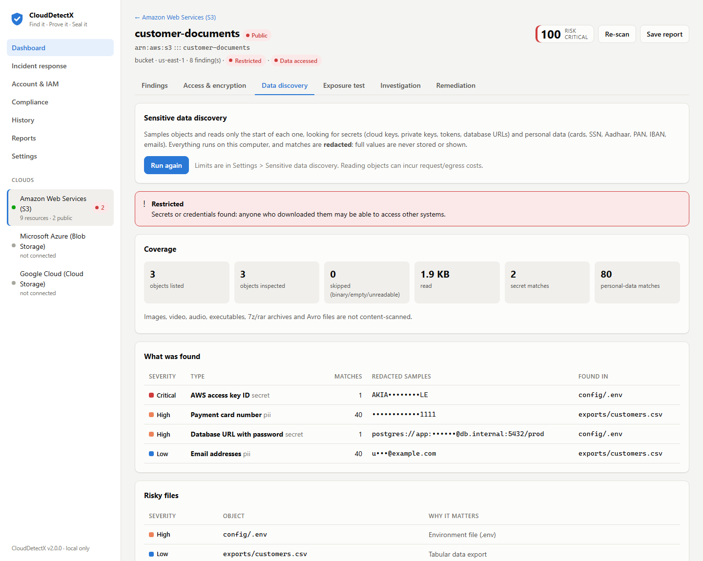

# 🛡️ CloudDetectX

[](https://pypi.org/project/clouddetectx/)
[](https://pypi.org/project/clouddetectx/)
[](https://github.com/dipanshwave/CloudDetectX-exposure-detector/actions/workflows/tests.yml)
[](https://github.com/dipanshwave/CloudDetectX-exposure-detector/blob/main/LICENSE)

> **Find it. Prove it. Seal it.** Find exposed cloud storage and risky account settings, prove what's reachable and what's inside, see who got in, and fix it, with a report at the end.

CloudDetectX checks **AWS, Azure and Google Cloud** for misconfigurations using your existing cloud logins. It runs as a local **web dashboard**, an **interactive terminal UI**, or **scriptable commands**.

<picture>
  <source media="(prefers-color-scheme: dark)" srcset="https://raw.githubusercontent.com/dipanshwave/CloudDetectX-exposure-detector/main/docs/screenshots/dashboard-dark.png">
  
</picture>

<sub>Screenshots use a simulated AWS account with fake data.</sub>

## What it does

- **Storage exposure**: public ACLs, policies, containers and access points; missing Block Public Access / Public Access Prevention; buckets shared with other accounts; CloudFront without origin access control.
- **Account-wide checks**: audit logging (CloudTrail, Activity Log, Data Access logs), root MFA and keys, password policy, firewalls open to the internet, public databases and snapshots, Kubernetes endpoints, KMS rotation, EBS default encryption.
- **IAM**: AWS users/roles/groups, Azure RBAC and GCP IAM. Finds admins, full-storage access, who can make buckets public, missing MFA and old keys, and who can access each bucket.
- **Proof and content**: anonymous requests prove what's reachable; data discovery finds secrets and personal data in text, PDF, Word/Excel/PowerPoint, zip/tar/gzip and Parquet files. Every match is redacted.
- **Investigation**: who downloaded what and from where, and who made it public, tagged with MITRE ATT&CK.
- **Scores and compliance**: risk per resource, a graded security score, and pass rates for NIST 800-53, CIS Controls v8, ISO 27001 and the CIS cloud benchmarks.
- **Fix and undo**: removes public access only, keeps other permissions, and can **roll back** from the saved configuration.
- **Accept risks**: mark intended exposure (e.g. a website bucket) with a reason and expiry date. It stops counting until it expires.
- **Scale**: parallel scanning and **all accounts** at once (AWS Organizations, every Azure subscription, every GCP project).
- **Reports and monitoring**: incident and compliance reports (Markdown, JSON, PDF), SARIF / OCSF / CSV exports, scan history and drift, webhook alerts, and **scheduled scans** (Task Scheduler / cron).

## Quick start

Requires Python 3.10 or newer.

```bash
pip install clouddetectx          # or: pipx install clouddetectx (keeps it in its own environment)
clouddetectx web                  # dashboard; the first visit opens the setup wizard
```

Upgrade later with `pip install -U clouddetectx`.

Everything is configured in the app: the setup wizard, **Settings** (web or terminal), or `clouddetectx config`. Settings are saved in `%APPDATA%\clouddetectx` (Windows) or `~/.config/clouddetectx` (Linux/macOS); set `CLOUDDETECTX_HOME` to use another folder. Secrets such as the webhook URL go to your **OS keychain** when one is available.

## Usage

```bash
clouddetectx web                            # web dashboard at http://127.0.0.1:8765
clouddetectx                                # interactive terminal menus

clouddetectx -p aws,azure,gcp scan          # scan + account checks + drift + alerts
clouddetectx -p aws scan --all-accounts     # every Organizations account / subscription / project
clouddetectx -p aws account                 # IAM and account-wide findings
clouddetectx -p aws verify my-bucket        # test from the internet, no credentials
clouddetectx -p aws discover my-bucket      # find secrets / personal data (redacted)
clouddetectx -p aws investigate my-bucket --days 90
clouddetectx -p aws remediate my-bucket --dry-run
clouddetectx rollback INC-20261118-054001-aws-my-bucket
clouddetectx -p aws waivers add my-website --check '*' --reason "public website" --expires 2027-06-30
clouddetectx -p aws compliance --report --pdf
clouddetectx -p aws export --format sarif -o findings.sarif   # also: ocsf, csv, all
clouddetectx -p aws schedule install --every 1440             # daily scan via Task Scheduler / cron
```

Exit codes: `0` nothing exposed, `2` exposure found, `1` error. Run `clouddetectx <command> --help` for options.

## Screenshots

| Account & IAM | Access & encryption |
|---|---|
|  |  |
| **Accepted risk** | **Rollback** |
|  |  |
| **Data discovery** | **Compliance** |
|  |  |

More are in [docs/screenshots](https://github.com/dipanshwave/CloudDetectX-exposure-detector/tree/main/docs/screenshots): setup wizard, investigation, exposure test, remediation, history, settings and [CLI output](https://github.com/dipanshwave/CloudDetectX-exposure-detector/blob/main/docs/screenshots/cli-scan.svg).

## Safety

- **Read-only by default.** Only remediation and rollback change anything. Both show the plan first and need you to type the resource name (or `-y` in scripts).
- **Minimal, reversible changes.** Only public access is removed (plus optional `--harden`). The previous configuration is saved in the report, and `rollback` restores it.
- **Secrets stay redacted** in reports, history, exports and the dashboard. Credentials go to the OS keychain.
- **The dashboard is local only**: it listens on `127.0.0.1` and is opened with a one-time link.

## Permissions

| | Read-only (scan, account, investigate) | Discovery | Remediation and rollback |
|---|---|---|---|
| **AWS** | `SecurityAudit` + `s3:GetObject` on log buckets | `s3:ListBucket`, `s3:GetObject` | `s3:PutBucketPublicAccessBlock`, `PutBucketAcl`, `PutBucketPolicy`, `DeleteBucketPolicy`, `PutObjectAcl` |
| **Azure** | `Reader`, `Monitoring Reader`, `Log Analytics Reader` | `Storage Blob Data Reader` | `Storage Account Contributor` |
| **GCP** | `roles/iam.securityReviewer`, `roles/logging.privateLogViewer`, `roles/cloudsql.viewer`, `roles/compute.viewer`, `roles/container.viewer` | `roles/storage.objectViewer` | `storage.buckets.update`, `storage.buckets.setIamPolicy`, `storage.objects.setIamPolicy` |

**All accounts**: AWS needs `organizations:ListAccounts` in the management (or delegated admin) account, plus a read-only role in each member account (set its name under *Settings > AWS*). Azure and GCP use every subscription/project your login can read.

**First real run:** start with `clouddetectx whoami`, then a read-only `scan`. If a check lacks permission it is skipped and listed, never fatal. Limit account checks to the regions you use under *Settings > AWS > Regions for account checks* for faster scans.

## Limits

- Not a full CSPM: storage, IAM and the account-wide checks above are covered. Compute instance settings, serverless code, container images and IaC aren't.
- IAM analysis reads policies directly. It doesn't evaluate SCPs, permission boundaries or condition values (marked "conditional"). Azure principals are shown by object ID.
- Compliance mapping is audit evidence, not a certification.
- Discovery can't read images, 7z/rar archives or encrypted PDFs. Reading objects can incur request/egress charges.

## Development

